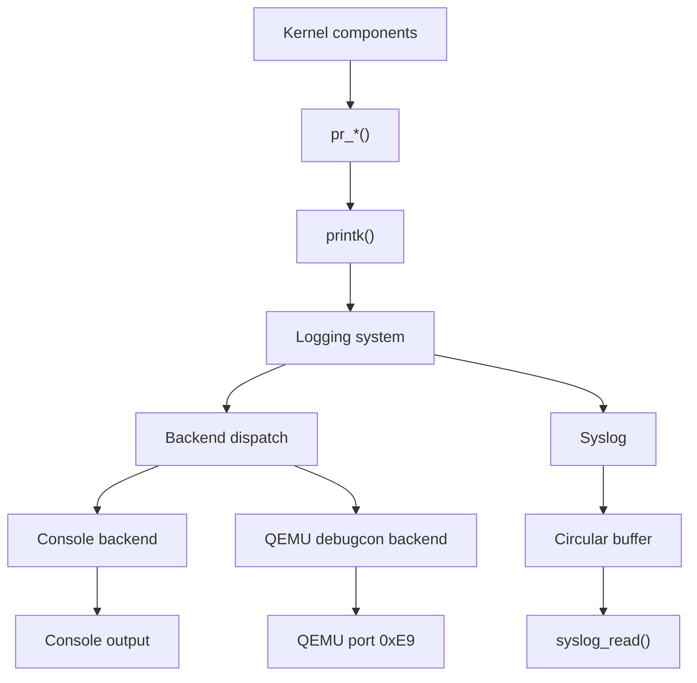

# Log System

The kernel syslog provides an interface for storing kernel messages.

It uses a fixed-size circular buffer to store recent log records, allowing them to be inspected independently of the active log output backends.

The logging system is divided into two components:

- **Log backends**: receive log records and forward them to output destinations
- **Syslog**: stores log records in memory for later inspection

## Log Backends
A log backend is an output destination registered with the logging system
Each backend provides a `write()` callback that receives a logical `log_record`.

Backends are registered independently and receive records through the backend dispatch mechanism

## Diagram

